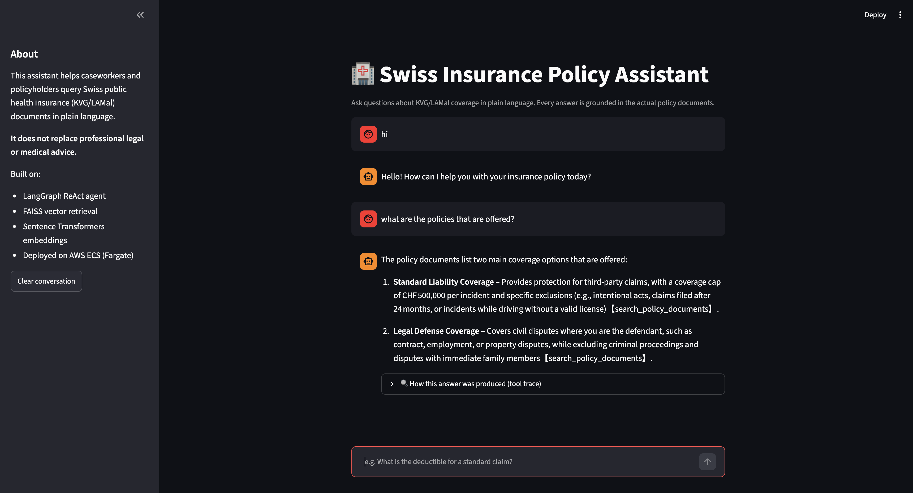
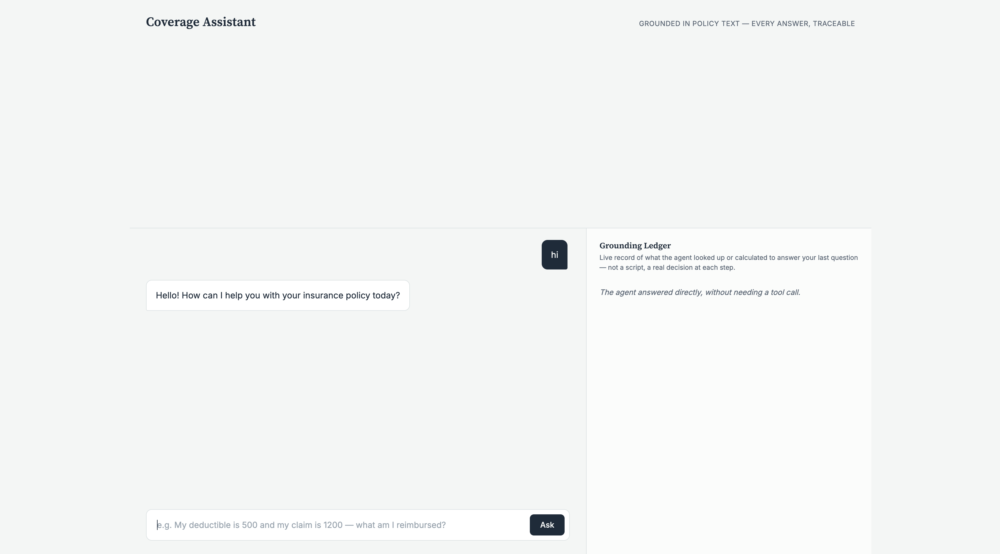

# Insurance Agent — Production

A production-grade LLM-powered Q&A assistant for Swiss public health insurance (KVG / LAMal) documents. Built to demonstrate the full journey from a research prototype to an industrialised system deployed on AWS.

> Built as a portfolio project targeting real-world ML engineering requirements: partner brief, latency budgets, GDPR-compliant logging, versioned configs, CI/CD, and a non-technical user interface.

---

## Screenshots

### Streamlit Frontend (localhost:8501)

*Plain-language chat interface for non-technical caseworkers. Every answer is grounded in policy documents and shows a tool trace.*

### FastAPI Built-in UI (localhost:8080)

*The original HTML frontend served directly by FastAPI, with a Grounding Ledger showing every tool call the agent made.*

---

## What it does

A caseworker types a question in plain language — *"What is the deductible if I file three claims this year?"* — and the system searches the policy documents, retrieves the relevant clauses, and returns a grounded, cited answer in under two seconds.

```
Caseworker → Streamlit UI → FastAPI → LangGraph ReAct agent
                                           ├── FAISS vector search (policy docs)
                                           ├── Calculator (claim amounts)
                                           └── Glossary (insurance terms)
                                                   │
                                             LLM (Groq / Anthropic / OpenAI)
```

---

## Who it was built for

A fictitious Swiss cantonal insurance office (see [PARTNER_BRIEF.md](PARTNER_BRIEF.md)) that handles thousands of KVG/LAMal policy queries per year. The brief drove the production requirements: 2-second latency budget, GDPR-compliant logging, multilingual support (DE / FR / EN), and deployability in the EU (AWS Frankfurt).

---

## Project structure

```
insurance_agent/
├── agent.py                     ← LangGraph ReAct agent loop
├── tools.py                     ← Tools: RAG search, calculator, glossary
├── documents.py                 ← Synthetic KVG/LAMal policy corpus
├── serve.py                     ← FastAPI: /health /metrics /ask + logging
├── docker-compose.yml           ← Local dev: API + Streamlit together
├── Dockerfile                   ← Production-hardened image with HEALTHCHECK
├── requirements.txt
├── app/
│   ├── api/middleware.py        ← Structured JSON logging → AWS CloudWatch
│   └── frontend/
│       └── streamlit_app.py     ← Plain-language chat UI (non-technical users)
├── configs/
│   └── rag_v1.yaml              ← Versioned RAG config (retriever + LLM + latency budget)
├── data/corpus/                 ← Policy documents (see README inside to swap in real docs)
├── infra/aws/
│   ├── ecs_task_definition.json ← ECS Fargate task definition
│   └── cloudwatch_dashboard.json← CloudWatch dashboard (latency + errors)
├── mlops/
│   ├── mlflow/track_experiment.py ← MLflow experiment tracking
│   └── github-actions/ci-cd.yml   ← CI/CD: lint → test → ECR → ECS deploy
├── tests/test_api.py            ← API integration tests (5 tests, all passing)
├── PARTNER_BRIEF.md             ← Problem statement + production requirements
├── ARCHITECTURE.md              ← System diagram + design decisions
└── DEPLOYMENT.md                ← Step-by-step: local → Docker → AWS
```

---

## Quickstart

```bash
cp .env.example .env     # fill in your LLM API key (Groq free tier works)
pip install -r requirements.txt
uvicorn serve:app --reload --port 8080
# API + built-in UI: http://localhost:8080
# Health check:      http://localhost:8080/health
# Metrics:           http://localhost:8080/metrics
```

Streamlit frontend (second terminal):
```bash
streamlit run app/frontend/streamlit_app.py
# Chat UI: http://localhost:8501
```

With Docker (API + Streamlit together):
```bash
docker-compose up --build
```

Full step-by-step guide including AWS deployment: [DEPLOYMENT.md](DEPLOYMENT.md)

---

## Production features added over the prototype

| Feature | File |
|---|---|
| Structured JSON logging → AWS CloudWatch | `app/api/middleware.py` |
| `/health` endpoint (ECS health check) | `serve.py` |
| `/metrics` endpoint (latency, error rate, p95) | `serve.py` |
| Versioned RAG config — A/B testable | `configs/rag_v1.yaml` |
| MLflow experiment tracking | `mlops/mlflow/track_experiment.py` |
| Streamlit frontend for non-technical users | `app/frontend/streamlit_app.py` |
| CI/CD: lint → test → ECR push → ECS deploy | `mlops/github-actions/ci-cd.yml` |
| ECS Fargate task definition | `infra/aws/ecs_task_definition.json` |
| CloudWatch dashboard (latency + error queries) | `infra/aws/cloudwatch_dashboard.json` |
| Production Dockerfile with HEALTHCHECK | `Dockerfile` |
| Docker Compose for local production parity | `docker-compose.yml` |
| Integration tests (5 passing) | `tests/test_api.py` |
| Partner brief + production requirements | `PARTNER_BRIEF.md` |
| Architecture diagram + design decisions | `ARCHITECTURE.md` |

---

## Key design decisions

See [ARCHITECTURE.md](ARCHITECTURE.md) for the full system diagram and a table of design decisions with rationale (FAISS vs OpenSearch, stateless API, structured logging, etc.).

---

## Extending to real documents

Replace `documents.py` with a PDF loader pointed at your document folder. See [data/corpus/README.md](data/corpus/README.md) for instructions and links to public Swiss BAG/FINMA insurance document sources.

---

## Running tests & linting

```bash
PYTHONPATH=. pytest tests/ -v
ruff check .
```

---

## Tech stack

`Python` · `LangGraph` · `LangChain` · `FastAPI` · `FAISS` · `Sentence Transformers` · `Streamlit` · `MLflow` · `Docker` · `AWS ECS Fargate` · `AWS CloudWatch` · `GitHub Actions`

---

## Engineering notes :— what broke and how I fixed it

[NOTES.md](NOTES.md) documents the real, unplanned breakage this project hit during development: LangChain API restructures, three successive model deprecations, a retrieval bug traced to what gets embedded (not just what gets retrieved), and three rounds of prompt iteration to close grounding failures without trading one failure mode for another. Worth reading if you want to understand how the project was actually built, not just what it does.
